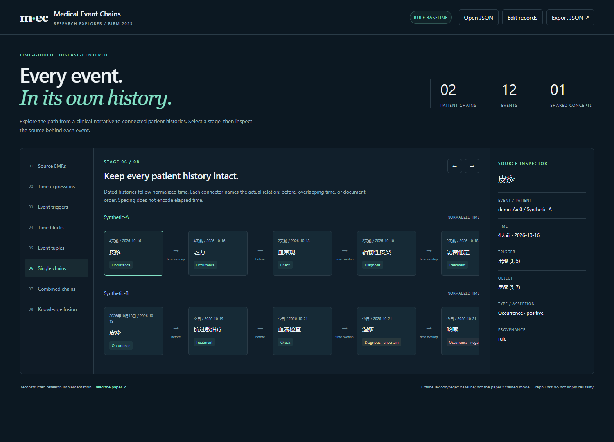

# Medical Event Chains

**A reconstructed research implementation of the time-guided combined medical event chain method (IEEE BIBM 2023).**

中文：根据残存的 `final_test.py`、论文和 `emr-event-atlas.html` 重建的可运行工程，包括抽取、事件链构建、跨患者组合、知识图谱融合、触发词训练和交互网页。**这不是找回的原版完整代码，也不包含原始模型权重或临床训练数据。**

> Lishuang Li, Tianqi Hu, Xueyang Qin. *A Time-Guided Method for Constructing Combined Medical Event Chains*. IEEE BIBM 2023, pp. 2027–2030. [Paper / DOI](https://doi.org/10.1109/BIBM58861.2023.10385422)



## Run in one minute

Python 3.10+; the default offline pipeline has **no third-party dependencies**.

```bash
git clone https://github.com/htqnlp/Medical-Event-Chains.git
cd Medical-Event-Chains
python -m venv .venv
# Windows PowerShell:
.venv\Scripts\Activate.ps1
# macOS / Linux: source .venv/bin/activate
python -m pip install -e .
python -m medical_event_chains demo
```

Open `artifacts/demo/report.html` in a browser. It is a **self-contained report**: no CDN, model download or server required. `report.json` contains the same source-preserving data.

The runnable default is an explicitly labeled **rule baseline**, not the paper's trained extraction model. It demonstrates the full chain construction flow with newly written synthetic records. A small built-in lexicon limits extraction coverage; an unrecognized entity is not evidence that it is absent from the record.

## Interactive extraction website

```bash
python -m pip install -e ".[web]"
mec serve
```

Open **http://127.0.0.1:8000**, choose **Edit records**, and run extraction. Eight views show source records → time expressions → triggers → time blocks → event tuples → single chains → combined chains → graph fusion. Select a trigger, tuple or card to inspect the exact original offsets and assertions. Export or reopen pipeline JSON results.

The server binds to the local machine by default and sends no patient text to an external service. Optional model initialization downloads model files. Do not expose this unauthenticated research server to a public network.

## Extract your own records

```bash
mec extract --input medical_event_chains/examples/records.json --output artifacts/my-chains
```

Input JSON:

```json
{
  "records": [
    {
      "record_id": "record-001",
      "patient_id": "synthetic-A",
      "admission_date": "2026-10-20",
      "text": "4天前出现皮疹。今日接受抗过敏治疗。"
    }
  ]
}
```

`admission_date` is optional. Without an anchor, relative dates remain unresolved rather than becoming today's date. Supply multiple patients with the same positive disease/symptom to obtain a combined chain. An optional `knowledge_graph` input connects matching concepts to user-supplied nodes; the example graph is synthetic and **is not CMeKG**. See [data formats](docs/data-formats.md).

## What has been reconstructed

| Component | Implementation and status |
| --- | --- |
| Temporal extraction | Regex baseline; optional UIE/WordTag time spans; conservative date/interval normalization |
| Trigger detection | Trainable BERT → per-sentence BiLSTM → three-sentence BiGRU → additive fusion → softmax |
| Arguments | Offline lexicon baseline; optional UIE + WordTag adapter based on the surviving script |
| Events | `[Time, Trigger, Object, Type]`, patient/record provenance, exact spans, negation and uncertainty |
| Single chains | Temporal relations within a patient; unresolved histories keep document order |
| Combined chains | Exact positive disease/symptom matches retrieve complete histories from multiple patients |
| Knowledge fusion | Explicit user-supplied KG nodes/edges and concept matches, with provenance |
| Training/evaluation | BIO annotations, MLEE/BRAT conversion, checkpointing, exact span/type micro P/R/F1 |
| Visualization | Dynamic extraction explorer, standalone HTML/JSON reports, original reference walkthrough |

**Missing from the surviving material:** original training code, exact hyperparameters, trained weights, original data splits, CCKS patient records and the original CMeKG snapshot. The new implementation makes explicit engineering choices for details absent from the paper. Published paper scores are **not reproduced or claimed** here. See [paper mapping and reconstruction decisions](docs/reconstruction.md).

## Train the trigger detector

Install optional PyTorch and Transformers dependencies:

```bash
python -m pip install -e ".[neural]"
python -m medical_event_chains.neural.train train \
  --train path/to/train.jsonl --dev path/to/dev.jsonl \
  --encoder bert --bert bert-base-chinese \
  --epochs 10 --lr 2e-5 --output checkpoints/clinical
```

Commands with `\` line continuations are Bash examples; in PowerShell put the command on one line or replace `\` with a backtick. The defaults are new implementation defaults, **not recovered paper hyperparameters**. A fast tokenizer is required. Long sentences, misaligned offsets, overlapping BIO triggers and cross-sentence annotations raise errors instead of silently dropping data.

```bash
python -m medical_event_chains.neural.train evaluate --checkpoint checkpoints/clinical --data path/to/test.jsonl
python -m medical_event_chains.neural.train predict --checkpoint checkpoints/clinical --text "今日出现皮疹。"
```

An entirely offline **software smoke test** uses random character embeddings, not BERT:

```bash
python -m medical_event_chains.neural.train train --train medical_event_chains/examples/trigger_train.jsonl --dev medical_event_chains/examples/trigger_dev.jsonl --encoder tiny --epochs 3 --lr 0.01 --hidden-size 16 --output checkpoints/smoke
```

Synthetic examples only establish that training executes. They do not establish medical accuracy. The clinical extraction backend deliberately rejects tiny smoke checkpoints.

For MLEE trigger experiments:

```bash
python -m medical_event_chains.mlee path/to/mlee/train artifacts/mlee-train.jsonl
```

Obtain data through its authorized source. MLEE is an **English biomedical** corpus; use an appropriate English BERT (for example `--bert bert-base-cased`) for that experiment. Its biomedical event labels do not map automatically to the five clinical chain categories. See [training format and conversion constraints](docs/data-formats.md).

## Optional PaddleNLP and hybrid extraction

The surviving script used `uie-medical-base`, WordTag and a dependency parser. The new `paddle` adapter uses pretrained UIE and WordTag, with conservative local trigger/argument pairing instead of the fragile original index manipulation. A `hybrid` backend replaces scene triggers with a newly trained clinical BERT-BiLSTM-BiGRU checkpoint.

```bash
mec extract --input records.json --backend paddle --output artifacts/paddle
mec extract --input records.json --backend hybrid --checkpoint checkpoints/clinical --output artifacts/hybrid
```

**Paddle integration was tested with API-shaped mocks, not downloaded Paddle models.** Use a separate compatible environment; see [Paddle setup](docs/paddle.md). An error never silently falls back to the rule baseline. MLEE trigger scores and clinical chain extraction are separate tasks.

## Validation

```bash
python -m pip install -e ".[neural,web,test]"
python -m pytest -q
```

Tests cover source offsets, calendar boundaries, relative/coarse/unresolved time, negation, patient isolation, grouping, KG validation, API limits, BIO conversion, recurrent padding, real BERT architecture forward/backward (random small config without downloading weights), tiny training and checkpoint reload. [Validation record](docs/validation.md) distinguishes execution tests from model-quality evaluation.

## Provenance

- `legacy/final_test_sanitized.py`: surviving exploratory code, with the embedded medical narrative replaced by a short synthetic example. **Archive only; do not run as the project entry point.** The original local file was not modified.
- `legacy/requirement.txt`: original note, **not a pip requirements file**.
- `web/reference/emr-event-atlas.html`: supplied standalone illustrative walkthrough, preserved as a reference. Its hardcoded examples and animation are not model output.
- `medical_event_chains/`: newly reconstructed implementation.
- No original clinical records, paper PDF, model weights or third-party KG dump are distributed.

This is a research/educational tool, not a clinically validated system. Exact string grouping is not medical concept normalization, temporal adjacency is not causality, and example graph relations are not treatment advice.

No general reuse license has been selected for this repository. Public visibility does not change the licenses or rights of referenced papers, models, datasets or dependencies. A citation is supplied in [CITATION.cff](CITATION.cff).
